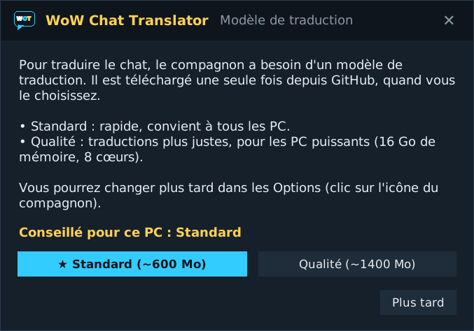
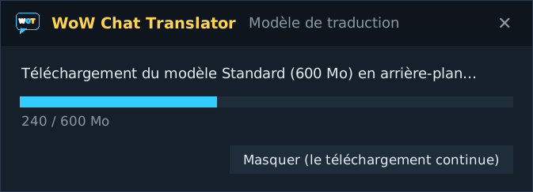
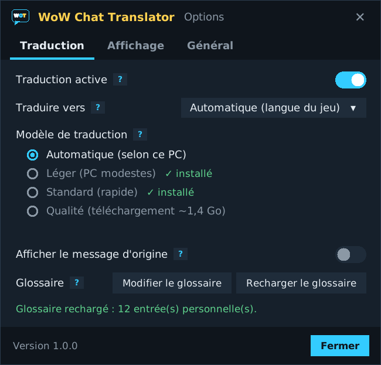
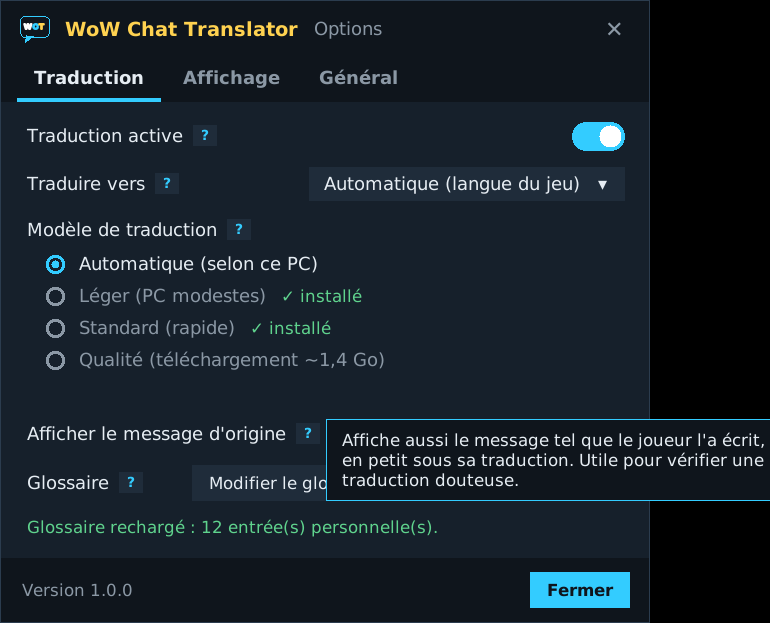
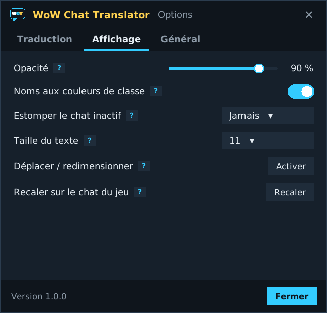
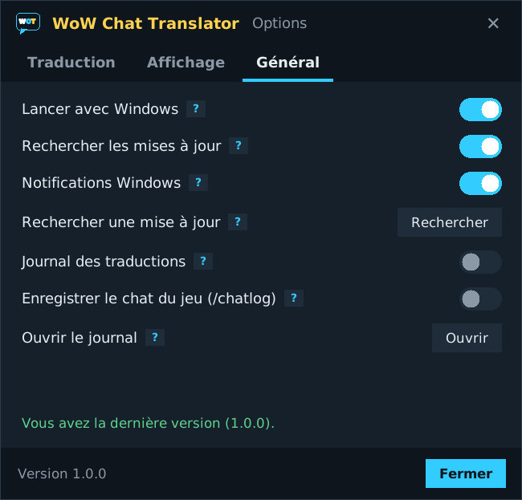

# WoWChatTranslator (Français)

Français | [English](#wowchattranslator-english) | [Wiki](https://github.com/Emzime/WoWChatTranslator/wiki) | [Aperçu / Preview](#aper%C3%A7u--preview)

> [!WARNING]
> **Projet en cours de construction.** Des fonctions peuvent changer ou ne pas encore marcher comme prévu, et les traductions s'améliorent au fil des versions.

Traduction instantanée et locale du chat de **World of Warcraft Forever**, dans la langue de chaque joueur.

## Ce que ça fait

- Traduit en direct les messages des autres joueurs dans votre langue, dans une fenêtre qui remplace le chat du jeu (la « surcouche »).
- Fonctionne **sur votre PC, sans serveur ni compte** : la traduction est faite par un modèle d'intelligence artificielle installé avec le compagnon. Aucun message n'est envoyé sur Internet.
- 21 langues de lecture : français, anglais, allemand, espagnol, italien, portugais, russe, polonais, néerlandais, suédois, danois, norvégien, finnois, tchèque, slovaque, roumain, hongrois, turc, grec, ukrainien, bulgare.
- Garde le jargon du jeu tel quel (tank, heal, DPS, M+, WTS, noms de donjons…) et remet les termes courants dans votre langue (classes, métiers, « merci », « lol »…).
- Infobulles Wowhead (base WoW Forever, dans votre langue) au survol des liens d'objets, de sorts et de quêtes.
- Capture d'écran avec la traduction (raccourci réglable dans le jeu).

## Installation

1. Téléchargez `WoWChatTranslatorCompagnion.zip` dans la [dernière release](https://github.com/Emzime/WoWChatTranslator/releases/latest).
2. Avant d'extraire : clic droit sur le zip → **Propriétés** → cochez **Débloquer** → OK.
3. Extrayez le dossier où vous voulez (ailleurs que dans `Program Files` de préférence).
4. Lancez `WoWChatTranslatorCompagnion.exe`. Au premier lancement :
   - il trouve World of Warcraft (sinon il vous demande le dossier) ;
   - il installe et active l'addon tout seul ;
   - il vous propose de télécharger un modèle de traduction (Standard ~600 Mo ou Qualité ~1,4 Go, celui qui convient à votre PC est indiqué). Rien n'est téléchargé tant que vous n'avez pas cliqué. Le modèle est enregistré dans un dossier `models` à côté de l'exécutable ;
   - son icône apparaît près de l'horloge.
5. Lancez le jeu depuis le menu de l'icône (**Lancer…**) ou normalement.

Le compagnon se met à jour tout seul depuis GitHub (désactivable dans les Options).

L'addon seul est aussi disponible dans chaque release (`WoWChatTranslator-addon.zip`), pour une installation à la main dans `Interface\AddOns`. Il ne fait rien sans le compagnon, qui l'installe de toute façon lui-même.

## Documentation

Tout le reste est dans le **[wiki](https://github.com/Emzime/WoWChatTranslator/wiki)** :

- [Utilisation](https://github.com/Emzime/WoWChatTranslator/wiki/Utilisation) : canaux traduits, fonctionnement, icône du compagnon, commandes et raccourcis en jeu
- [Fenêtre Options](https://github.com/Emzime/WoWChatTranslator/wiki/Options)
- [Modèles de traduction](https://github.com/Emzime/WoWChatTranslator/wiki/Modèles-de-traduction)
- [Glossaire personnel](https://github.com/Emzime/WoWChatTranslator/wiki/Glossaire-personnel)
- [Confidentialité et sécurité](https://github.com/Emzime/WoWChatTranslator/wiki/Confidentialité-et-sécurité)
- [Problèmes connus](https://github.com/Emzime/WoWChatTranslator/wiki/Problèmes-connus)
- [Compiler depuis les sources](https://github.com/Emzime/WoWChatTranslator/wiki/Compiler-depuis-les-sources)

## Crédits et licences

Ce projet est **gratuit et non commercial**. Le modèle de traduction NLLB-200 est sous licence CC-BY-NC 4.0, qui interdit tout usage commercial ; le projet complet ne peut donc pas être vendu ni utilisé commercialement.

### Modèles et données

| Élément | Auteur | Licence |
|---|---|---|
| [NLLB-200 distilled 600M](https://huggingface.co/facebook/nllb-200-distilled-600M) et [1.3B](https://huggingface.co/facebook/nllb-200-distilled-1.3B) | Meta AI (*No Language Left Behind*, NLLB Team et al., 2022) | [CC-BY-NC 4.0](https://creativecommons.org/licenses/by-nc/4.0/) |
| [OPUS-MT](https://github.com/Helsinki-NLP/Opus-MT) (optionnel, si ajouté à la compilation) | Université d'Helsinki, Helsinki-NLP | [CC-BY 4.0](https://creativecommons.org/licenses/by/4.0/) |
| Infobulles d'objets, sorts et quêtes | [Wowhead](https://www.wowhead.com) | Données affichées depuis le service de Wowhead, propriété de Wowhead |
| Noms officiels des zones, donjons et raids (`companion/data/places.json`), des races, réputations et objets (`companion/data/names.json`) | Blizzard Entertainment, extraits des tables du jeu WoW Forever via [wago.tools](https://wago.tools) | Propriété de Blizzard Entertainment |
| Modèle de détection de langue [py3langid](https://github.com/adbar/py3langid) (d'après langid.py de M. Lui et T. Baldwin) | Adrien Barbaresi | BSD 3-Clause |

Référence du modèle : NLLB Team et al., *No Language Left Behind: Scaling Human-Centered Machine Translation*, 2022. [arXiv:2207.04672](https://arxiv.org/abs/2207.04672).

### Bibliothèques

| Bibliothèque | Licence |
|---|---|
| [CTranslate2](https://github.com/OpenNMT/CTranslate2) (OpenNMT) | MIT |
| [SentencePiece](https://github.com/google/sentencepiece) (Google) | Apache 2.0 |
| [py3langid](https://github.com/adbar/py3langid) | BSD 3-Clause |
| [NumPy](https://numpy.org) | BSD 3-Clause |
| [Pillow](https://python-pillow.org) | MIT-CMU (HPND) |
| [pystray](https://github.com/moses-palmer/pystray) | LGPL 3.0 |
| [python-mss](https://github.com/BoboTiG/python-mss) | MIT |
| [DXcam](https://github.com/ra1nty/DXcam) | MIT |
| [comtypes](https://github.com/enthought/comtypes) | MIT |
| [truststore](https://github.com/sethmlarson/truststore) | MIT |
| [certifi](https://github.com/certifi/python-certifi) | MPL 2.0 |
| [Python](https://www.python.org) et Tcl/Tk | PSF License / BSD |
| [PyInstaller](https://pyinstaller.org) (compilation) | GPL 2.0 avec exception pour les programmes compilés |
| [Transformers](https://github.com/huggingface/transformers) et [PyTorch](https://pytorch.org) (conversion des modèles, compilation uniquement) | Apache 2.0 / BSD |

### Marques

World of Warcraft, Warcraft et Blizzard Entertainment sont des marques de Blizzard Entertainment, Inc. Ce projet est indépendant : il n'est ni affilié, ni approuvé, ni soutenu par Blizzard Entertainment ou par Wowhead.

---

# WoWChatTranslator (English)

[Français](#wowchattranslator-fran%C3%A7ais) | English | [Wiki](https://github.com/Emzime/WoWChatTranslator/wiki) | [Aperçu / Preview](#aper%C3%A7u--preview)

> [!WARNING]
> **Work in progress.** Features may change or not work as expected yet, and translations improve with each version.

Instant, local translation of the **World of Warcraft Forever** chat into each player's own language.

## What it does

- Translates other players' messages live into your language, in a window that replaces the game chat (the "overlay").
- Runs **on your PC, with no server or account**: translation is done by an artificial intelligence model installed with the companion. No message is sent over the Internet.
- 21 reading languages: French, English, German, Spanish, Italian, Portuguese, Russian, Polish, Dutch, Swedish, Danish, Norwegian, Finnish, Czech, Slovak, Romanian, Hungarian, Turkish, Greek, Ukrainian, Bulgarian.
- Keeps game jargon as typed (tank, heal, DPS, M+, WTS, dungeon names…) and puts common terms back into your language (classes, professions, "thanks", "lol"…).
- Wowhead tooltips (WoW Forever database, in your language) when hovering item, spell and quest links.
- Screenshots that include the translation (key binding set in game).

## Installation

1. Download `WoWChatTranslatorCompagnion.zip` from the [latest release](https://github.com/Emzime/WoWChatTranslator/releases/latest).
2. Before extracting: right-click the zip → **Properties** → tick **Unblock** → OK.
3. Extract the folder anywhere you like (preferably outside `Program Files`).
4. Run `WoWChatTranslatorCompagnion.exe`. On first launch:
   - it finds World of Warcraft (or asks you for its folder);
   - it installs and enables the addon by itself;
   - it offers to download a translation model (Standard ~600 MB or Quality ~1.4 GB, the one suited to your PC is marked). Nothing is downloaded until you click. The model is saved in a `models` folder next to the executable;
   - its icon appears near the clock.
5. Start the game from the icon menu (**Launch…**) or as usual.

The companion updates itself from GitHub (can be turned off in the Options).

The addon alone is also attached to every release (`WoWChatTranslator-addon.zip`), for a manual install in `Interface\AddOns`. It does nothing without the companion, which installs it anyway.

## Documentation

Everything else is in the **[wiki](https://github.com/Emzime/WoWChatTranslator/wiki)**:

- [Usage](https://github.com/Emzime/WoWChatTranslator/wiki/Usage): translated channels, how it works, companion icon, in-game commands and key bindings
- [Options window](https://github.com/Emzime/WoWChatTranslator/wiki/Options-window)
- [Translation models](https://github.com/Emzime/WoWChatTranslator/wiki/Translation-models)
- [Personal glossary](https://github.com/Emzime/WoWChatTranslator/wiki/Personal-glossary)
- [Privacy and security](https://github.com/Emzime/WoWChatTranslator/wiki/Privacy-and-security)
- [Known issues](https://github.com/Emzime/WoWChatTranslator/wiki/Known-issues)
- [Building from source](https://github.com/Emzime/WoWChatTranslator/wiki/Building-from-source)

## Credits and licences

This project is **free and non-commercial**. The NLLB-200 translation model is licensed CC-BY-NC 4.0, which forbids any commercial use; the project as a whole may therefore not be sold or used commercially.

### Models and data

| Item | Author | Licence |
|---|---|---|
| [NLLB-200 distilled 600M](https://huggingface.co/facebook/nllb-200-distilled-600M) and [1.3B](https://huggingface.co/facebook/nllb-200-distilled-1.3B) | Meta AI (*No Language Left Behind*, NLLB Team et al., 2022) | [CC-BY-NC 4.0](https://creativecommons.org/licenses/by-nc/4.0/) |
| [OPUS-MT](https://github.com/Helsinki-NLP/Opus-MT) (optional, if added to the build) | University of Helsinki, Helsinki-NLP | [CC-BY 4.0](https://creativecommons.org/licenses/by/4.0/) |
| Item, spell and quest tooltips | [Wowhead](https://www.wowhead.com) | Data shown from Wowhead's service, property of Wowhead |
| Official zone, dungeon and raid names (`companion/data/places.json`), race, reputation and item names (`companion/data/names.json`) | Blizzard Entertainment, extracted from the WoW Forever game tables via [wago.tools](https://wago.tools) | Property of Blizzard Entertainment |
| Language detection model [py3langid](https://github.com/adbar/py3langid) (after langid.py by M. Lui and T. Baldwin) | Adrien Barbaresi | BSD 3-Clause |

Model reference: NLLB Team et al., *No Language Left Behind: Scaling Human-Centered Machine Translation*, 2022. [arXiv:2207.04672](https://arxiv.org/abs/2207.04672).

### Libraries

| Library | Licence |
|---|---|
| [CTranslate2](https://github.com/OpenNMT/CTranslate2) (OpenNMT) | MIT |
| [SentencePiece](https://github.com/google/sentencepiece) (Google) | Apache 2.0 |
| [py3langid](https://github.com/adbar/py3langid) | BSD 3-Clause |
| [NumPy](https://numpy.org) | BSD 3-Clause |
| [Pillow](https://python-pillow.org) | MIT-CMU (HPND) |
| [pystray](https://github.com/moses-palmer/pystray) | LGPL 3.0 |
| [python-mss](https://github.com/BoboTiG/python-mss) | MIT |
| [DXcam](https://github.com/ra1nty/DXcam) | MIT |
| [comtypes](https://github.com/enthought/comtypes) | MIT |
| [truststore](https://github.com/sethmlarson/truststore) | MIT |
| [certifi](https://github.com/certifi/python-certifi) | MPL 2.0 |
| [Python](https://www.python.org) and Tcl/Tk | PSF License / BSD |
| [PyInstaller](https://pyinstaller.org) (build) | GPL 2.0 with an exception for built programs |
| [Transformers](https://github.com/huggingface/transformers) and [PyTorch](https://pytorch.org) (model conversion, build only) | Apache 2.0 / BSD |

### Trademarks

World of Warcraft, Warcraft and Blizzard Entertainment are trademarks of Blizzard Entertainment, Inc. This project is independent: it is not affiliated with, endorsed or sponsored by Blizzard Entertainment or Wowhead.

---

## Aperçu / Preview

<!-- Surcouche en jeu / in-game overlay: add docs/images/overlay.png here once captured. -->

  
  

  
  

  
  

