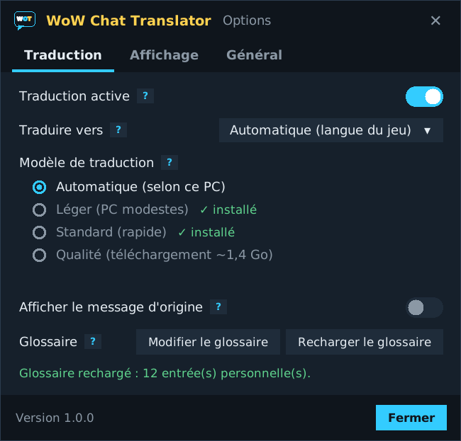

# WoWChatTranslator

Traduction instantanée et locale du chat de **World of Warcraft Forever**, dans la langue de chaque joueur.
Instant, local translation of the **World of Warcraft Forever** chat into each player's own language.

[Télécharger / Download](https://github.com/Emzime/WoWChatTranslator/releases/latest) · [Dépôt / Repository](https://github.com/Emzime/WoWChatTranslator)

| Français | English |
|---|---|
| [Installation](Installation) | [Installing](Installing) |
| [Utilisation](Utilisation) | [Usage](Usage) |
| [Fenêtre Options](Options) | [Options window](Options-window) |
| [Modèles de traduction](Modèles-de-traduction) | [Translation models](Translation-models) |
| [Glossaire personnel](Glossaire-personnel) | [Personal glossary](Personal-glossary) |
| [Confidentialité et sécurité](Confidentialité-et-sécurité) | [Privacy and security](Privacy-and-security) |
| [Problèmes connus](Problèmes-connus) | [Known issues](Known-issues) |
| [Compiler depuis les sources](Compiler-depuis-les-sources) | [Building from source](Building-from-source) |

