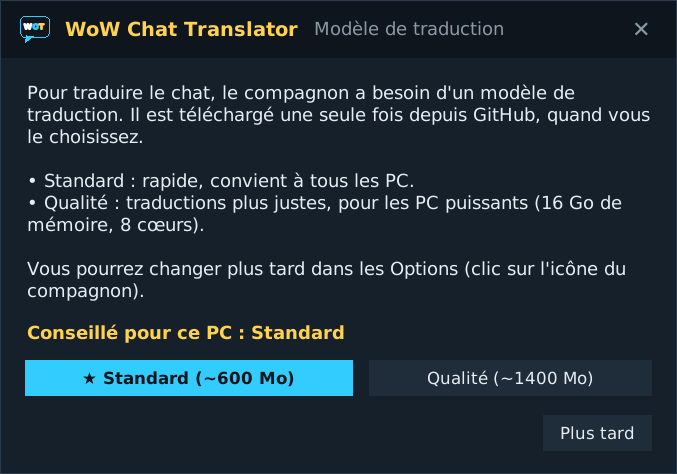
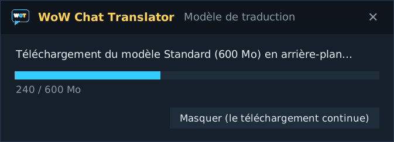

## Configuration requise

- Windows 10 (version 2004 ou plus récente) ou Windows 11.
- World of Warcraft Forever (Battle.net).
- Environ 1 Go d'espace disque (2,5 Go avec le modèle Qualité).
- 8 Go de mémoire conseillés (16 Go et 8 cœurs pour le modèle Qualité).

## Installation

1. Téléchargez `WoWChatTranslatorCompagnion.zip` dans la [dernière release](https://github.com/Emzime/WoWChatTranslator/releases/latest).
2. Avant d'extraire : clic droit sur le zip → **Propriétés** → cochez **Débloquer** → OK.
3. Extrayez le dossier où vous voulez (ailleurs que dans `Program Files` de préférence).
4. Lancez `WoWChatTranslatorCompagnion.exe`. Au premier lancement :
   - il trouve World of Warcraft (sinon il vous demande le dossier) ;
   - il installe et active l'addon tout seul ;
   - il vous propose de télécharger un modèle de traduction (Standard ~600 Mo ou Qualité ~1,4 Go, celui qui convient à votre PC est indiqué). Rien n'est téléchargé tant que vous n'avez pas cliqué. Le modèle est enregistré dans un dossier `models` à côté de l'exécutable ;
   - son icône apparaît près de l'horloge.
5. Lancez le jeu depuis le menu de l'icône (**Lancer…**) ou normalement.

Le compagnon se met à jour tout seul depuis GitHub (désactivable dans les Options).

L'addon seul est aussi disponible dans chaque release (`WoWChatTranslator-addon.zip`), pour une installation à la main dans `Interface\AddOns`. Il ne fait rien sans le compagnon, qui l'installe de toute façon lui-même.

## Premier lancement

