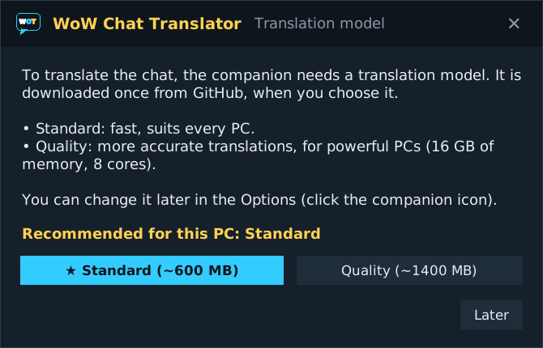
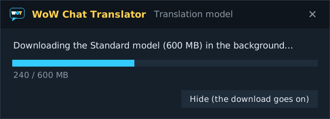

## Requirements

- Windows 10 (version 2004 or later) or Windows 11.
- World of Warcraft Forever (Battle.net).
- About 1 GB of disk space (2.5 GB with the Quality model).
- 8 GB of memory recommended (16 GB and 8 cores for the Quality model).

## Installation

1. Download `WoWChatTranslatorCompagnion.zip` from the [latest release](https://github.com/Emzime/WoWChatTranslator/releases/latest).
2. Before extracting: right-click the zip → **Properties** → tick **Unblock** → OK.
3. Extract the folder anywhere you like (preferably outside `Program Files`).
4. Run `WoWChatTranslatorCompagnion.exe`. On first launch:
   - it finds World of Warcraft (or asks you for its folder);
   - it installs and enables the addon by itself;
   - it offers to download a translation model (Standard ~600 MB or Quality ~1.4 GB, the one suited to your PC is marked). Nothing is downloaded until you click. The model is saved in a `models` folder next to the executable;
   - its icon appears near the clock.
5. Start the game from the icon menu (**Launch…**) or as usual.

The companion updates itself from GitHub (can be turned off in the Options).

The addon alone is also attached to every release (`WoWChatTranslator-addon.zip`), for a manual install in `Interface\AddOns`. It does nothing without the companion, which installs it anyway.

## First launch

