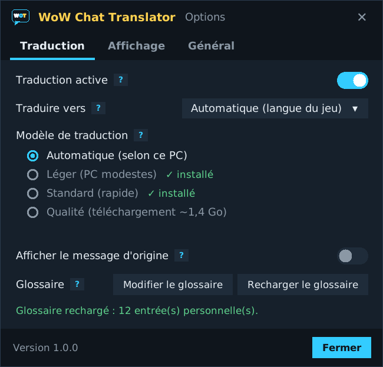
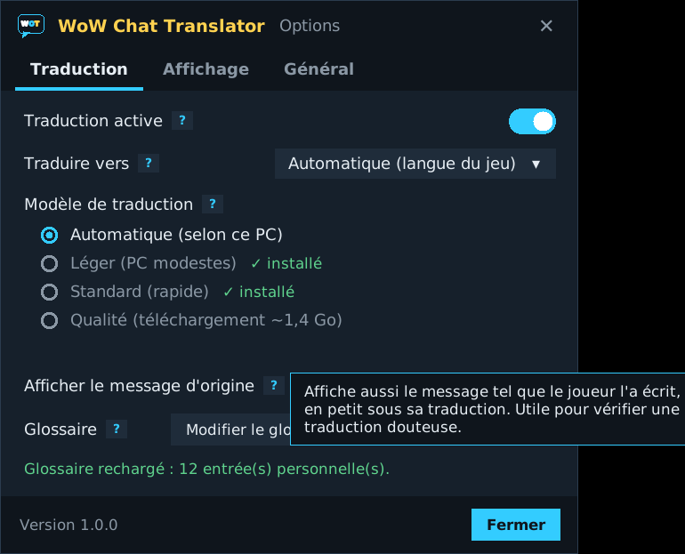
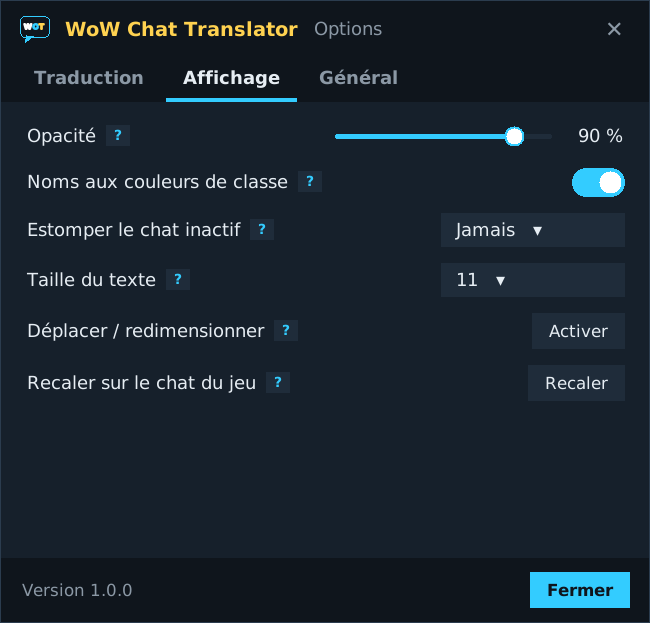
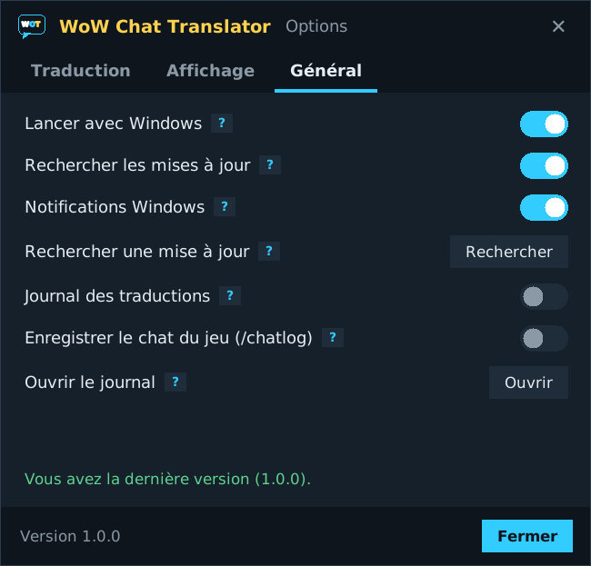

| Tab | Settings |
|---|---|
| Translation | Translation on/off; reading language (automatic: the game's language, otherwise Windows'); translation model (Automatic, Light, Standard, Quality, see [Translation models](Translation-models), with the download status); show the original message under its translation; edit / reload the glossary (your own words, see [Personal glossary](Personal-glossary)) |
| Display | Opacity; class-coloured names (like the game chat); fade the idle chat (after 15 s to 5 min without a new message, like the game chat; it comes back as soon as a message arrives or the mouse passes over it); text size; move / resize; snap back to the game chat |
| General | Start with Windows; check for updates (a window offers each new version: **Update now**, with the download shown, **When closing the companion** or **Later**; nothing is downloaded without your consent; checked at launch, every hour and when closing, where it offers **Update and quit** or **Quit without updating**); Windows notifications (can be turned off); translation log (each message, the detected language and the translation, to report an error); record the game chat (`/chatlog`, to get back the messages missed while the game is hidden; applied at the next `/reload`, and follows the command typed in game); check for an update; open the log; version |

Changes apply at once. Every setting has a **?** bubble explaining what it does, and every button shows the result of its action (glossary reloaded, update check…). The buttons that move the overlay are only active while the game is running.

