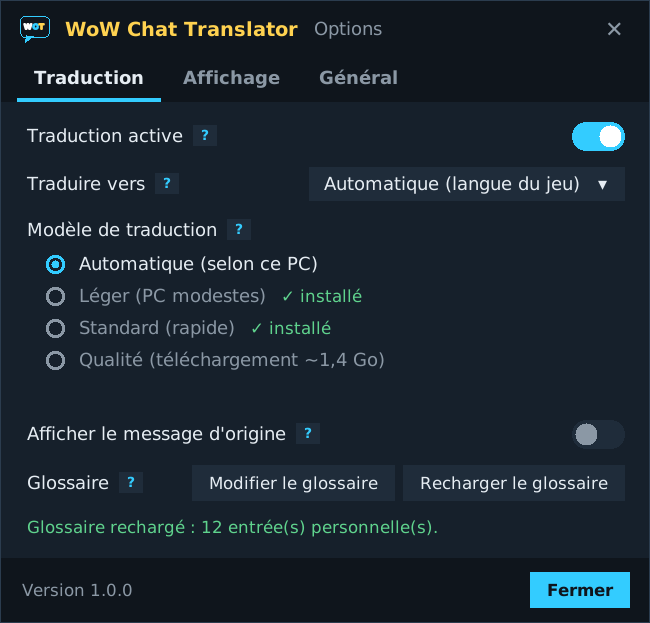
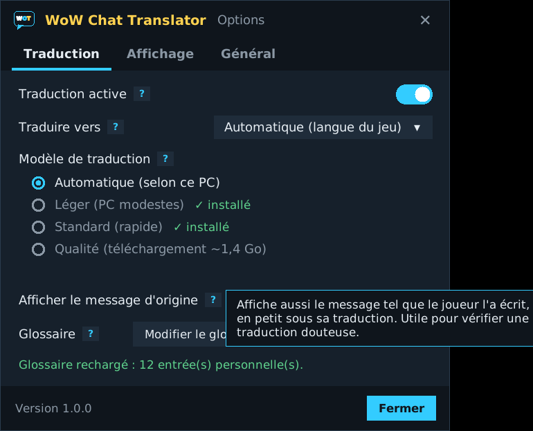
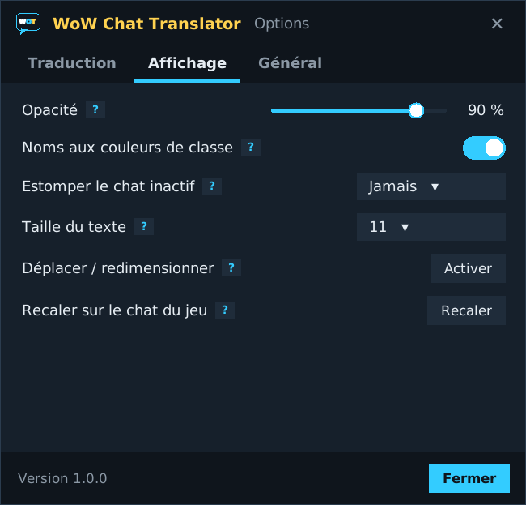
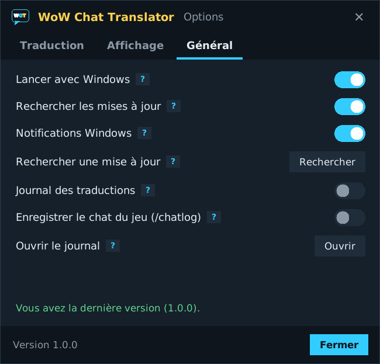

| Onglet | Réglages |
|---|---|
| Traduction | Traduction active ; langue de lecture (automatique : langue du jeu, sinon de Windows) ; modèle de traduction (Automatique, Léger, Standard, Qualité, voir [Modèles de traduction](Modèles-de-traduction), avec l'état du téléchargement) ; afficher le message d'origine sous sa traduction ; modifier / recharger le glossaire (vos propres mots, voir [Glossaire personnel](Glossaire-personnel)) |
| Affichage | Opacité ; noms aux couleurs de classe (comme le chat du jeu) ; estomper le chat inactif (après 15 s à 5 min sans nouveau message, comme le chat du jeu ; il revient dès qu'un message arrive ou que la souris passe dessus) ; taille du texte ; déplacer / redimensionner ; recaler sur le chat du jeu |
| Général | Lancer avec Windows ; rechercher les mises à jour (une fenêtre propose chaque nouvelle version : **Mettre à jour maintenant**, avec le téléchargement affiché, **À la fermeture du compagnon** ou **Plus tard** ; rien n'est téléchargé sans votre accord ; vérification au lancement, toutes les heures et à la fermeture, où elle propose **Mettre à jour et quitter** ou **Quitter sans mettre à jour**) ; notifications Windows (désactivables) ; journal des traductions (chaque message, la langue détectée et la traduction, pour signaler une erreur) ; enregistrer le chat du jeu (`/chatlog`, pour retrouver les messages manqués pendant que le jeu est caché ; appliqué au prochain `/reload`, et suit la commande tapée en jeu) ; rechercher une mise à jour ; ouvrir le journal ; version |

Les changements s'appliquent tout de suite. Chaque réglage a une bulle **?** qui explique à quoi il sert, et chaque bouton affiche le résultat de son action (glossaire rechargé, recherche de mise à jour…). Les boutons qui déplacent la surcouche ne sont actifs que lorsque le jeu est lancé.

